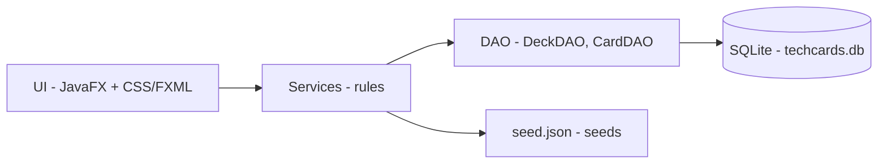

# techcards

**English** · [Português (Brasil)](README.md)

[](#) [](#) [](#)

## What it is

This repository holds the **slide presentation** for the **TechCards** project: an offline desktop flashcard app for studying Operating Systems, Computer Architecture and Instrumental English — an academic project for a Computer Science course.

The `index.html` file is a navigable deck (arrow keys ← →) explaining the product, the delivered scope, the technical decisions, the numbers and the roadmap. It describes the JavaFX application; the app's source code is not in this repository.

## Status

A working, navigable presentation with no build step. Academic project (TechCards app v1.2.0).

## Features

- **Slide deck**: keyboard (← →) and control navigation.
- **Project content**: context (4 subjects), delivered scope, stack decisions, study flow, numbers, phased roadmap and MCP proposal.
- **Custom dark theme**: palette taken from the application's design system (JavaFX/CSS).

## What the presentation documents

The TechCards app (Java 21 + JavaFX 21 + SQLite):

- **Five screens**: Decks, Cards, Study, Dashboard and Settings.
- **90 cards in 3 decks** (OS, Architecture, English), seeded on first run.
- **Protected CRUD**: the default deck is read-only; duplicate to edit.
- **Configurable study**: shuffled queue (random or by difficulty), 3D flip, sound and streak.
- **Error-oriented dashboard**: top 5 mistakes, per-deck performance, score and daily streak.
- **Backup and restore**: export/import `.db`, restore seeds, clear history; logical deletion.
- **46 automated tests** (JUnit 5), 74.5 MB packaged with an embedded JRE via `jpackage`.

## Architecture (of the described app)



Dependencies flow one way: UI → Services → DAO → SQL. That isolates the business rules, enables headless tests and confines any database change to the DAO.

## Stack (of this repo)

- Pure HTML5 + CSS3 + JavaScript (static deck, no build)
- No dependencies, no server

## Repository layout

```
techcards/
├── index.html     # slide presentation of the TechCards project
├── README.md      # pt-BR version
└── README.en.md   # this file
```

## How to run

Open `index.html` in any browser:

```bash
# any of these
start index.html
# or serve locally
python -m http.server 8000
# then open http://localhost:8000
```

Navigation: arrow keys ← → (or the on-screen controls).

## Tests and quality

Static deck, no automated tests in this repository. The described app declares 46 JUnit tests (DAO, seed, CRUD, study and metrics).

## Technical decisions and trade-offs

- **Single `index.html` deck**: easy to open and share; in exchange, all content lives in one large file.
- **Dark theme with animated grid and blobs**: intentional for the presentation; the palette mirrors the real app.

## Known limitations and roadmap

- **Presentation only**: the TechCards source (JavaFX/SQLite) is not in this repository.
- Project roadmap (in the presentation): publish the code, UI polish, exam mode, spaced repetition (SM-2-like), search, PDF import and a local MCP server.

## Development process

An individual project by Kelvin Oliveira, built with orchestrated AI agents and reviewed by the author. The project content and the review are the author's.

## License and author

**Author**: [Kelvin Oliveira](https://github.com/KelvinOliveiraCode) · [Portfolio](https://kelvinoliveiracode.github.io/portfolio/)
