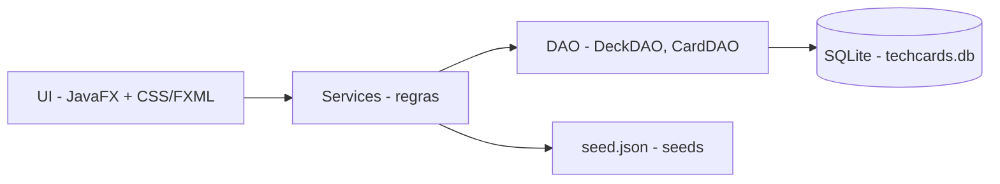

# techcards

[English](README.en.md) · **Português (Brasil)**

[](#) [](#) [](#)

## O que é

Este repositório contém a **apresentação em slides** do projeto **TechCards**: uma aplicação desktop offline de flashcards para estudo de Sistemas Operacionais, Arquitetura de Computadores e Inglês Instrumental — trabalho acadêmico do curso de Ciência da Computação.

O arquivo `index.html` é um deck navegável (setas ← →) que explica o produto, o escopo entregue, as decisões técnicas, os números e o roadmap. Ele descreve o aplicativo JavaFX; o código-fonte do app não está neste repositório.

## Status

Apresentação funcional e navegável, sem build. Projeto acadêmico (aplicativo TechCards v1.2.0).

## Funcionalidades

- **Deck em slides**: navegação por teclado (← →) e por controles.
- **Conteúdo do projeto**: contexto (4 disciplinas), escopo entregue, decisões de stack, fluxo de estudo, números, roadmap em fases e proposta MCP.
- **Tema escuro próprio**: paleta extraída do design system do aplicativo (JavaFX/CSS).

## O que a apresentação documenta

O aplicativo TechCards (Java 21 + JavaFX 21 + SQLite):

- **Cinco telas**: Decks, Cards, Estudo, Dashboard e Configurações.
- **90 cards em 3 decks** (SO, Arquitetura, Inglês), semeados no primeiro uso.
- **CRUD protegido**: deck padrão somente-leitura; duplicar para editar.
- **Estudo configurável**: fila embaralhada (aleatório ou por dificuldade), virada 3D, som e streak.
- **Dashboard orientado a erro**: top 5 erros, desempenho por deck, aproveitamento, streak.
- **Backup e restauração**: exportar/importar `.db`, restaurar seeds, limpar histórico; exclusão lógica.
- **46 testes automatizados** (JUnit 5), 74,5 MB empacotado com JRE embarcado via `jpackage`.

## Arquitetura (do aplicativo descrito)



Dependências numa direção só: UI → Services → DAO → SQL. Isso isola a regra de negócio, permite testes sem interface e trocar de banco mexe apenas no DAO.

## Stack (deste repositório)

- HTML5 + CSS3 puro + JavaScript (deck estático, sem build)
- Sem dependências, sem servidor

## Estrutura do repositório

```
techcards/
├── index.html     # apresentação em slides do projeto TechCards
├── README.md      # este arquivo (pt-BR)
└── README.en.md   # versão em inglês
```

## Como executar

Abra o `index.html` em qualquer navegador:

```bash
# qualquer um destes
start index.html
# ou sirva localmente
python -m http.server 8000
# e acesse http://localhost:8000
```

Navegação: setas ← → (ou clique nos controles).

## Testes e qualidade

Deck estático, sem testes automatizados neste repositório. O aplicativo descrito declara 46 testes JUnit (DAO, seed, CRUD, estudo e métricas).

## Decisões técnicas e trade-offs

- **Deck em um único `index.html`**: simples de abrir e transportar; em troca, todo o conteúdo vive num arquivo grande.
- **Tema escuro com grid animado e blobs**: intencional para a apresentação; a paleta reflete o app real.

## Limitações conhecidas e roadmap

- **Apenas a apresentação**: o código-fonte do TechCards (JavaFX/SQLite) não está neste repositório.
- Roadmap do projeto (na apresentação): publicar o código, acabamento de interface, modo prova, revisão espaçada (tipo SM-2), busca, importação de PDF e servidor MCP local.

## Processo de desenvolvimento

Projeto individual de Kelvin Oliveira, construído com agentes de IA orquestrados e revisado pelo autor. O conteúdo do projeto e a revisão são do autor.

## Licença e autor

**Autor**: [Kelvin Oliveira](https://github.com/KelvinOliveiraCode) · [Portfólio](https://kelvinoliveiracode.github.io/portfolio/)
